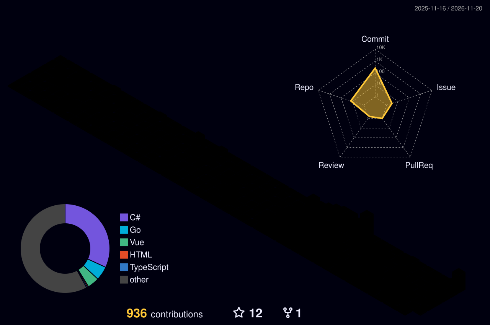

  

  
  
  
  

## About

I'm Minh (Vũ Gia Minh), a developer from Vietnam. I build plugins for game servers and web applications, and I enjoy turning bubble tea into code.

- Owner and developer of **7-Màu Community**
- Maintain plugins for large-scale **HvH servers** (China region)
- Experience across Counter-Strike 2, CS:GO and GTA V (FiveM) server ecosystems

## Currently

- Building plugins with **CounterStrikeSharp** and **SwiftlyS2**
- Learning **TypeScript**, **Next.js** and **cloud infrastructure**

  
  
  
  

## Tech stack

<table>
  <tr>
    <td><b>Frontend</b></td>
    <td></td>
  </tr>
  <tr>
    <td><b>Backend</b></td>
    <td></td>
  </tr>
  <tr>
    <td><b>Databases</b></td>
    <td></td>
  </tr>
  <tr>
    <td><b>Cloud &amp; tools</b></td>
    <td></td>
  </tr>
</table>

## GitHub stats

  

  
  

  
  

## Contribution activity

  

  

